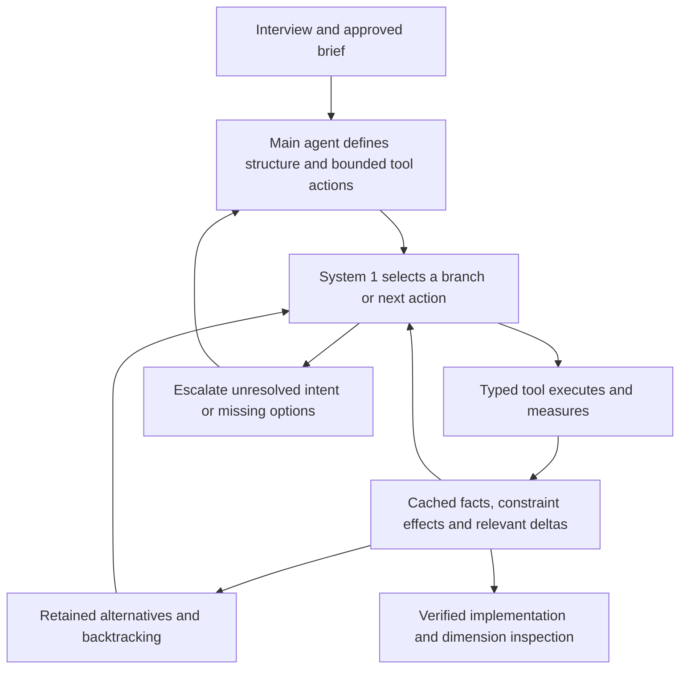

# ADR 001: measured constraints, local factors, revisable alternatives

Date: 2026-10-24. Status: implemented measurement/choice toolkit; brief-driven repeated System 1 orchestration unimplemented; empirical preference validation pending.

The tool needs to expose the consequences of local design choices without claiming a universal aesthetic function. Typography is discontinuous at wraps, fallback and font changes. A selector must not certify geometry or invent evidence.

Use a versioned platform-neutral state, deterministic font/rendering adapters, an explicit dependency graph, and bounded candidate search. Keep each conditional factor and its source/uncertainty visible. Filter hard failures before Pareto comparison. Preserve alternatives. Do not sum factors into beauty. The invalidation DAG is not a joint probability model: dependent suggestions are proposals for another measurement pass, avoiding cyclic conditionals pretending to define a probability distribution.

Fontkit 2.0.4 provides actual OpenType glyph shaping, metrics and single-run ink bounds. Kerning changes glyph positioning; extra tracking is a separate property. Final line breaking, bidi segmentation, fallback and platform behavior belong to the renderer. Web receipts come from the actual React 19.2 / StyleX 0.19.1 output compiled by the StyleX Babel plugin and rendered by Playwright. Chromium revision is recorded rather than assumed. Native receipts come only from the Expo 58 / React Native 0.88 harness's native events and Yoga rectangles. Native capability gaps are errors/unsupported reports, not browser substitutes.

Positive dimensions can be compared with log2(a/b). Tracking and zero gaps cannot be logarithmically compared as positive dimensions; tracking is normalized to em and zero gaps get an explicit rhythm bin. Compatibility curves are nonnegative weighted soft peaks, normalized by total peak weight. They are neither probability densities nor calibrated preference probabilities. Sigma must be positive. Off-scale proposals remain available. Entropy and ordered motifs are descriptors; surprise requires an attributed observed count distribution.

Smooth priors are the default. Musical landmarks are switchable hypotheses applied to hierarchy proposals and factor curves. A controlled ablation fixes candidate budget, content, font files, measurement, stress cases and the one selector. The candidate interventions differ; cosmetic relabeling of identical proposals would not test the hypothesis. If both hierarchy dimensions are locked, the search reports that the relationship cannot be intervened on. The visual-preference outcome remains undetermined until licensed held-out projects and blinded human observations exist. Discard the musical prior if the preregistered evidence shows no practical advantage; retain measurement, coupling and the tool interfaces.

All numerical tracking/leading/measure/gap/hierarchy targets in the spike are **uncalibrated local heuristics**. Empirical sources support conditional relationships, not these coefficients. Raw renderer facts, standards checks, practitioner guidance and hypotheses keep separate provenance. The registry makes those distinctions machine-readable.

The CLI owns JSON stdin/stdout and diagnostics. Shared `execute()` handlers own validation and dispatch. MCP stdio wrappers call those handlers. Files are resolved locally; no SaaS API is required. Proof artifacts embed only recorded licensed fonts. Optional MCP App code is bundled independently; the CLI does not require a UI host.

The native bridge is authenticated and loopback-only. Jobs expire after five minutes, leases expire after thirty seconds, and result identity is bound to the state/font-content hash, platform, ordered block IDs and loaded fonts. The adapter additionally checks native content preservation and geometry. Receipts are observations from the connected harness, not cryptographic proof against a malicious local runtime. Font fallback policy is conservative: absent primary glyphs are rejected until explicit fallback-chain verification is implemented.

SemIf is a subprocess adapter, used only after fresh deterministic feasibility checks. The provisional model is fixed to `Qwen/Qwen3.5-4B`, tokenizer revision `851bf6e806efd8d0a36b00ddf55e13ccb7b8cd0a`, quantized local GGUF. The inspected upstream SemIf revision is `23cf1f39fc9534fe81437200959b6dfc7106e45a` at <https://github.com/TheoLeeCJ/SemIf>. The adapter matches its `semif-score --mode direct --backend llamacpp --model ... --revision ... --gguf ... --input ... --output ...` contract and checks returned checkpoint SHA-256. A checksum binds the supplied file; it does not establish a checkpoint's training history. No generated prose, model confidence, or selector probability establishes validity. Contract fixtures test integration logic without pretending to run inference.

Consequences: renderer startup and multiple stress passes cost local latency; bounded search is not globally optimal. Script/language-specific readability, optical whitespace, verified fallback chains, device coverage, React Strict DOM parity and preference calibration remain research/integration work. Browser DOM range bounds are not final glyph ink. Native text-spacing support differs from web markup; no full WCAG conformance claim follows from this spike.

## Extension decisions

Color uses opaque sRGB inputs, exact scoped contrast constraints and optional OKLCH descriptors. Composition consumes explicit rectangles/groups and returns separate geometry facts. Neither creates a beauty sum. Palette changes invalidate color factors and reach actual StyleX/native output without pretending to alter glyph metrics.

MCP defaults to three compact discovery/execution/specimen tools. Command schemas are discovered lazily; a bounded session store retains exact values for JSON-pointer references. Full named wrappers remain opt-in. This reduces declaration context, not a demonstrated reduction in end-to-end agent tokens.

The original provisional 4B selector remains the evaluation baseline. A separately pinned 0.8B experimental profile answers the user's memory-fit question; it is not a second model benchmark. Its balanced option readout is an engineering diagnostic for order sensitivity. One configured checkpoint runs per selection. Synthetic Astra ratings and held-out project records support export/probe mechanics; no training or human aesthetic validation occurred. See [selector evidence](selector-and-training.md).

## Required component contract and inspection layer

Status: proposed and required for the broader mission; not implemented by the current toolkit. [Dimensional Drawing](https://github.com/enesozturk/dimensional-drawing/tree/5c457437c8c83524308aad3b7443e81adcc13153) is an MIT-licensed practitioner reference for source-backed symbolic dimension sheets. [Pinned sources](../research/dimensional-drawing-provenance.json). Adopt the precision and variable-based presentation; preserve our own measurement and evidence contract.

A component instance needs stable semantic slot identities; content, border, painted, hit and clipping bounds; padding/gaps; baselines and text lines; radii and layers; intrinsic/minimum measures; flex behavior; platform/viewport/text scale; and state transitions. Distinguish authored values, renderer observations, algebraically derived values, hypotheses and unknowns. Attach source/runtime/font/state identity and coordinate units. A content-independent anatomy sheet must coexist with an actual-content typography overlay: text-dependent wrapping cannot be removed from the mathematics.

For one bordered horizontal component with uniform border B, inline padding P, leading slot I, flexible text F, trailing action A and two gaps G1/G2, the inner allocation closes as:

```text
W = 2B + 2P + I + G1 + F + G2 + A
H = 2B + Pt + max(HI, Htext, HA) + Pb
F >= minimum measured text allocation for this state/topology
```

When that topology cannot satisfy its constraints, search a declared stacked variant and remeasure. Do not silently shrink controls or clip content. For deliberately concentric uniform insets, an inner radius derives from the actual outer radius, border and inset, capped by the inner box; this relation is conditional, not a universal radius recipe. Baseline/optical alignment requires real font/ink evidence; missing optical geometry stays unknown.

Musical interval families and recurring gap motifs would then be conditional relationships between comparable variables in this graph. A possible choice potential is `U_k = -log(max(epsilon, A_k(r|C)))`, retained separately for each relationship. This is a proposed transformation of a declared prior, not physical energy or a calibrated aesthetic likelihood. Keep interval/rhythm deviation, measured wrap-event distance, and hard collision/content constraints distinct. No universal sum or automatic preference follows. A useful expressive system must preserve multiple feasible regimes and intentional departures, not relax every relationship to uniform repetition.

The intended flow is one contract graph → measured state → candidate relationships/search → actual render → technical inspection sheet. An MCP App resource can project the same JSON into anatomy, detail, responsive/state and dependency views; the drawing must not have separately invented values or its own design rules. Editing a variable invalidates dependent measurements and redraws only after recomputation. The current `ui://physics-of-design/specimens.html` does not implement this component inspector.

Acceptance requires the full web/app examples to consume this shared graph; materially different full compositions generated from it; phone/tablet/desktop and changed-content/state tests; independent blind critique; and recorded rule changes that improve held-out output. Dimensional correctness alone does not satisfy the visual-quality target.

## Brief-driven System 1 tool decision tree

User clarification: music is one optional theory. Physics and energy name the coupled influences exposed through tools; no separate physical simulation or universal beauty potential is required. The architecture begins with a realistic interview, product truth, visual direction, actual content/assets and platform constraints. Preserve settled context; ask only about material gaps. The pinned [Impeccable intake](https://github.com/pbakaus/impeccable/blob/936867543ac2576920d663cc9803597f6044f3ac/.agents/skills/impeccable/reference/init.md) and [new-work workflow](https://github.com/pbakaus/impeccable/blob/936867543ac2576920d663cc9803597f6044f3ac/.agents/skills/impeccable/reference/new-work.md) are practitioner precedents for capturing that context. The task is not to design without a brief or forbid art direction.

System 1 is one configured local selector called repeatedly. It chooses bounded alternatives using compact relevant tool observations and the current brief. The main agent owns intent, creative proposals, implementation/integration and exceptions; it should not re-reason every local relationship. Tools apply parameterized changes, shape/render/measure, report constraints and conditional factor effects, and invalidate dependent observations. The search tree records those transitions and preserves alternate branches for revision/backtracking. Its lineage is distinct from the variable dependency graph.

The intended loop is:



Each node needs parent/branch identity, brief/state references, the selected typed action, observations and scenario provenance, changed paths, invalidated factors, constraints/factor deltas and remaining work/cost budget. A selector chooses registered action/option IDs; it does not invent tool arguments or factual results. Distinguish selecting a well-typed observation/expansion action before its outcome is known from accepting a completed design alternative: accepted alternatives still require deterministic feasibility evidence. Model readouts never certify validity or become an overall beauty score. Tool failures update the branch and permit revision/backtracking; no valid continuation or a creative/intention gap returns to the main agent. Routine implementation does not require repeated human approval.

The current implementation does not implement this controller. `relax()` enumerates a flat batch, and `choiceSelect()` selects after measuring viable alternatives. There is no persisted next-action tree, node-level selector context or measured main-agent escalation policy. Each current selection also launches a SemIf subprocess; repeated-call operation requires measurement of residency/batching, startup and context reuse rather than assuming that a small model call is cheap. Exact immutable result references and valid measurement caches should keep repeated state/geometry out of main-agent context; dependency invalidation and runtime/font/scenario identity still govern reuse.

Evaluation compares the same approved interview/brief, assets, constraints and review policy under guidance-only main-agent reasoning versus main agent plus repeated System 1/tool decisions. Clarifications and art-direction feedback are allowed and recorded, not classified as failures merely for occurring. Report cloud/main-agent input/output and reasoning where exposed; local-selector calls/tokens and time separately; tool/render time; tree depth, branching/backtracking; repeated or invalid decisions; attempts/interactions to accepted quality; and blind full-product preference. Token savings mean reduced main-agent work at comparable quality, not silently moving cost out of the denominator. Musical-prior ablation is a secondary experiment. The earlier twelve-trial flat-candidate pilot does not test this controller.

Status: architectural contract and prospective evaluation only. No repeated-tree runtime or efficiency result is claimed by this clarification.
