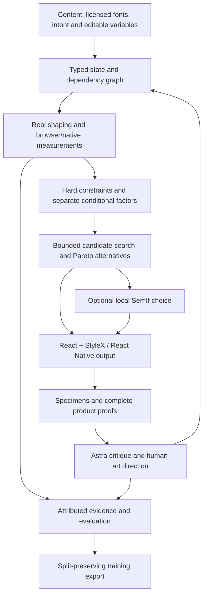

# What exists, how it is used, and what is still missing

The current stack has 55 validated decision commands, compact CLI/MCP access, precise component inspection, perceptual color and analytic motion. An authored brief becomes a bounded mathematical search, a graph of evaluated local choices and a resolved design machine. Vela consumes that machine as a complete six-screen web/native app. Fieldwork and the original two typography specimens remain available.

[The current report](design-theory-extension.md) records throughput, actual local selection, guarded replay, complete-app verification and remaining research limits. The mathematical inner loop is fast; the measured local neural readout is slow and remains outside it. No autonomous taste, award-level output or end-to-end token improvement is claimed.

## System map

Deterministic tools establish measurements and feasibility. Conditional factors propose choices without a total beauty score. A local model can select only among reverified viable alternatives. Rendered/task review finds things that the factors cannot yet express. Those findings become reusable rules when justified; they do not automatically become fitted aesthetic coefficients.

## Tools actually available

All 55 commands share typed validation across the JSON CLI and MCP. The CLI reads a JSON object or JSONL and writes JSON; diagnostics go to stderr. Tool availability depends on configuration: compiled CLI works locally; an agent host must be configured to expose the MCP server. Nothing silently installs itself into other agents.

| Layer                  | Commands                                                                                                                   | What they do                                                                                                                                 |
| ---------------------- | -------------------------------------------------------------------------------------------------------------------------- | -------------------------------------------------------------------------------------------------------------------------------------------- |
| Evidence/discovery     | `registry`                                                                                                                 | Sources, applicability, evidence class, uncertainty and capability limits.                                                                   |
| Fonts and real text    | `font inspect`, `text shape`, `typography inspect`, `typography axes`                                                      | Source-bound font metrics/outlines, separate kerning/tracking, guarded baselines, actual line breaks and bounded variable-axis probes.       |
| Conditional typography | `intervals candidates`, `relations score`, `rhythm analyze`                                                                | Log ratios, configurable smooth/musical peaks, separate conditional factors, ordered spacing motifs and entropy descriptors.                 |
| Measured layout        | `layout measure`                                                                                                           | Real browser/native geometry, wrap thresholds, clipping/content/spacing failures.                                                            |
| Coupling/search        | `system graph`, `system perturb`, `system relax`                                                                           | Dependency invalidation, safe editable mutations, pins/locks, bounded discrete/refinement search and multiple viable/Pareto choices.         |
| Responsive rules       | `responsive patterns`, `responsive resolve`                                                                                | Shared flex patterns, bounded editable anchors and minimum-measure fallback.                                                                 |
| Color                  | `color analyze`, `color candidates`, `color convert`, `palette ramp`, `palette analyze`, `palette candidates`              | Legacy opaque-sRGB contrast plus CSS4 conversion, explicit fallback, contextual role checks and bounded joint repair with locks.             |
| Composition/platform   | `composition plan`, `composition analyze`, `platform audit`                                                                | Editable flex/type/space proposals; rectangle/group/edge/size contracts; source-attributed Apple target/safe-area/scaling/navigation checks. |
| Mathematical decisions | `energy search`, `energy analyze`, `composition solve`, `decision handoff`, `decision replay`                              | Bounded weighted exploration, local pressures, graph provenance, executable handoffs and guarded reuse.                                      |
| Motion                 | `motion analyze`, `motion candidates`, `motion emit`, `motion proof`                                                       | Analytic spring behavior, bounded alternatives, platform mappings and inspection.                                                            |
| Staged decisions       | `decision run`, `validation plan`, `validation check`                                                                      | Conditional stage DAGs, cached selection paths and explicit responsive/tool receipt gates.                                                   |
| Media/materials        | `surface probe`, `surface map`, `surface textures`, `media analyze`, `media crops`, `material pair`, `material candidates` | Physical response, texture/channel semantics, source-pixel contrast, crop geometry and conditional finish relationships.                     |
| Inspection/prose       | `wireframe inspect`, `prose analyze`                                                                                       | Whole-layout dimensional drawings, editable MCP App and authored reader journeys.                                                            |
| Driven motion          | `motion dynamics`, `motion timeline`                                                                                       | Target work, dissipation and bounded runtime samples; optional GSAP/Lenis/browser tilt adapters.                                             |
| Component contracts    | `component solve`, `component inspect`                                                                                     | Exact declared slot geometry, measurement provenance and technical drawing from the same contract.                                           |
| Output/proof           | `emit`, `proof`                                                                                                            | React + StyleX or RN mapping/capability report; editable specimens, font comparison and guides.                                              |
| Optional local choice  | `choice select`                                                                                                            | Fresh deterministic verification followed by one configured SemIf checkpoint.                                                                |
| Research/data          | `corpus validate`, `corpus analyze`, `training export`, `evaluate`                                                         | Rights/project splits, rendered feature extraction, evidence-bound preference records and matched evaluation.                                |

`mcp` and `native serve` are transport/runtime entry points outside those 55 decision commands. Default MCP exposes three tools: `design_catalog`, `design_execute`, `design_specimen`. Catalog schemas are lazy, and exact session result references avoid repeatedly sending complete states/measurements. The optional full profile exposes 55 named wrappers plus those three. Compact discovery is measured by `npm run context:budget`; declaration size is distinct from end-to-end agent efficiency.

## Equations and rules

Implemented mathematics includes logarithmic intervals, configurable multi-peak compatibility, ordered motifs, local entropy, rectangle union/centroid/proximity, declared alignment contracts, focal-point cover geometry and concentric inset radii. Color separates required contrast from optional harmony descriptions. Responsive topology follows available measures and text enlargement; every layout uses flex.

Apple guidance has source IDs/provenance and executable checks where the inputs support them. The audit distinguishes current default versus minimum targets, measured safe areas, scaling observations and navigation continuity; missing evidence stays unknown and overall HIG conformance stays null. It does not encode every HIG page or certify native familiarity, VoiceOver, materials or task quality.

[The source comparison](skill-comparison.md) extracts 18 conditional practices from pinned Elaya/Impeccable sources. [The rule record](../research/design-rule-candidates.json) marks adopt/adapt/reject decisions and current tool coverage. This is a source-attributed research/rule pack; not every proposed semantic practice is an executable factor. Font bans, mandatory gradients and universal musical ratios are not adopted as laws.

## Components and design systems

The original brief explicitly excludes a component catalog/UI composer. Accordingly there is no general-purpose Button/Card/Navigation library here. Fieldwork has example-specific React/RN components and real app states, not exported production components.

Reusable design-system support exists at the relational/token layer:

- Typed font family/files/axes, size, weight, kerning, tracking, leading and measures.
- Semantic color roles, locks and contrast relationships.
- Responsive anchors, gutters, gaps, caps, density/expression parameters and flex topology.
- Separate related/group/section spacing roles, authored media-edge contracts and platform policies.
- React + StyleX emission and explicit RN support/unsupported reports.

The central `StateSchema` still models two text archetypes (`hero` and `editorial`), 2–8 text blocks, and title/subtitle/prose roles. The larger composition planner and rectangle analyzer are separate tools. The new design machine adds authored screen purposes, copy variants, region bindings and transition rules; the energy program propagates their numeric dependencies. It is not an arbitrary component-tree compiler. Fieldwork calls shared equations directly; it was not autonomously generated from that graph by SemIf.

There is no Figma or DTCG import/export, published component package, general component-variant/state compiler, visual regression corpus of arbitrary controls, or automatic token migration. Those would be new capabilities, not things implied by having color/type tokens. Vela exercises complete interactions, focus, analytic motion and platform geometry. Arbitrary product behavior, localization and platform familiarity still require appropriate real tests.

## Skills and agent workflow

The repository skill is now [design-theory](../.agents/skills/design-theory/SKILL.md), with progressively loaded composition, decision-machine, motion/material, typography and inspection/prose facets. The old physics-of-design entry routes to it. This remains repository-local; it is not silently installed as a global connector. Impeccable and Elaya were researched and compared. Current Astra critiques are synthetic reviews with explicit prompts and source boundaries; a live Impeccable execution is not claimed for the new gallery.

The primary agent implements/integrates and runs tests, invoking this CLI directly in the current workspace. The built MCP server has protocol/host-bridge tests but is not automatically installed as a global connector in every agent session. Explicitly prompted Astra agents review code and rendered designs, identify failures and suggest rule refinements. Two isolated synthetic rating passes exist for a frozen six-project-pair batch. They are model judgments, not human labels. Neither Astra nor the primary agent runs without instructions: delegation uses bounded prompts, and review findings trigger further implementation.

The actual coding-agent pilot used the same agent on guidance-only versus tool-assisted conditions, with tool-assisted arms explicitly told to use the tools. That historical pilot did not test repeated System 1 construction of a tool-guided decision tree. The new `decision run` protocol proof makes two sequential local readouts and replays with zero readouts, but it is not a new matched quality/cost trial. Interview, brief and art direction are normal inputs, not failures of autonomy. Fieldwork received both those inputs and iterative implementation feedback; that history is not a controlled cost comparison. The relevant target is fewer main-agent reasoning tokens and routine interventions at matched output quality, under the same brief and feedback policy.

## Runnable proofs and evidence

Original hero/editorial specimens exercise coupled type/spacing decisions. Fieldwork raises the composition bar: web cover/issue/article, native Journal/Explore/Saved/Reader, real search and empty recovery, save/remove, local persistence, reading preferences and position restoration. Its original generated images retain [prompts](../research/fieldwork-image-prompts.md) and [hash provenance](../research/fieldwork-asset-provenance.json).

Executed evidence includes real Fontkit and Chromium/React/StyleX, actual iPhone/iPad Text/Yoga and Android emulator measurements, a 720-input core matrix plus additional responsive/system-scaling cases, every CLI/MCP command, an actual MCP App bridge, real local SemIf inference, full-composition captures and Android gestures with independent accessibility/frame agreement and explicit keyboard events. Native screenshots are simulator/emulator evidence; wide artboards are not physical rotation tests. [Acceptance ledger](system-completion.md), [whole-system report](system-report.md), [design follow-up](fieldwork-design-followup.md), [code review](composition-code-review.md).

## Local model and training status

The actual optional MCP App is a specimen/review surface, not a page composer. Its SDK bridge is tested; it is not automatically mounted in every host.

The original quantized Qwen3.5-4B is the provisional selector. An explicit experimental 0.8B profile was added for memory fit; it is not a second taste judge benchmark. Real inference ran on both. The 0.8B GGUF is about 533MB, and the measured probe peak footprint was about 1.23GB under its tested configuration.

The tiny selector's initial probe was answer-order sensitive. Balanced readout improved repeatability to 6/6 on the revisited batch, but only 2/9 synthetic directional labels matched, including 0/4 held-out judgments. That does not establish design competence. No weights have been trained. Training export preserves project splits, raw synthetic labels, ties/abstentions and exact source image/state bindings. Six project pairs are too little evidence to claim a trained design judge.

## What the outcomes mean

The engineering stack exists and has substantial executed verification. The intended preference/efficiency advantage has not been established. The limited twelve-trial pilot used approximately 17.5% more tokens in tools-smooth, with more latency and no fewer attempts. No human preference ratings exist; musical superiority remains undetermined and smooth priors remain the default.

The required follow-up starts with an actual interview and product/visual brief. Both baseline and tool-assisted builders receive the same approved context, content, constraints and review policy. The tool-assisted arm uses repeated calls to one local System 1 selector to grow and revisit branches from deterministic tool outputs, rather than making one final choice after a flat search. Record main-agent tokens/calls separately from local-selector tokens/calls, measurement latency, branch exploration/backtracking, user interactions and final quality. Realistic clarification and art-direction feedback remain allowed and accounted for. The historical pilot is not a test of the current mathematical choice graph. The historical measured Vela run uses bounded numeric exploration and one final neural readout. The new staged protocol demonstrates two dependent readouts, selective invalidation and cached replay; it follows one selected DAG path without automatic downstream backtracking. Its preference and end-to-end cost advantage remain unevaluated. See the clarified architecture in [ADR001](adr-001.md#brief-driven-system-1-tool-decision-tree).

## New compact workflow

`composition solve` runs the bounded mathematical field and optional local neural readout, returning a machine and solver recipe. `decision replay` recomputes the saved machine with zero inference. `energy analyze` exposes finite-difference pressures; `component inspect` and `motion proof` use the existing optional MCP App. `palette` commands repair multiple coupled role tokens. See ADR002 and the current report for exact semantics, identity guards and limitations.

## Current extension proof

The React + StyleX developer gallery exercises three authored directions, real motion, worker PBR/fallback, editable materials, decision replay and matching layout/technical drawings. It was independently reviewed and corrected for first-frame presentation, state persistence and mobile text containment. Current typography proof samples 80 variable-font candidates across Chromium and WebKit, with guarded baseline evidence and explicit optical-size divergence. [Extension report](design-theory-extension.md), [gallery review](gallery-astra-review.md), [typography precision](typography-measurement.md), [validation phases](validation-phases.md). Native baseline/axis extraction, physical Safari/tilt and human preference remain explicit gaps.
