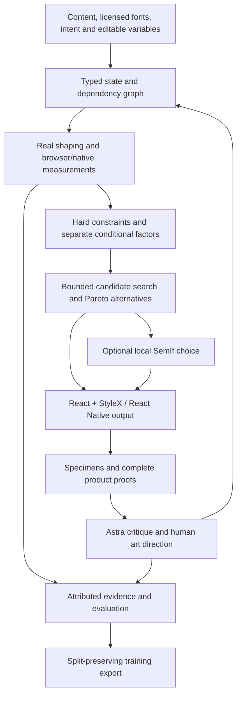

# What exists, how it is used, and what is still missing

This is an implemented local typography/color/geometry toolkit, an evidence and review workflow, and two kinds of runnable proof. It is not yet an autonomous product designer or a complete component/design-system compiler. Fieldwork is a deliberately demanding application of the shared mathematics, implemented by the primary agent and refined through explicit Astra review tasks.

## System map

Deterministic tools establish measurements and feasibility. Conditional factors propose choices without a total beauty score. A local model can select only among reverified viable alternatives. Rendered/task review finds things that the factors cannot yet express. Those findings become reusable rules when justified; they do not automatically become fitted aesthetic coefficients.

## Tools actually available

All 24 commands share typed validation across the JSON CLI and MCP. The CLI reads a JSON object or JSONL and writes JSON; diagnostics go to stderr. Tool availability depends on configuration: compiled CLI works locally; an agent host must be configured to expose the MCP server. Nothing silently installs itself into other agents.

| Layer                  | Commands                                                           | What they do                                                                                                                                 |
| ---------------------- | ------------------------------------------------------------------ | -------------------------------------------------------------------------------------------------------------------------------------------- |
| Evidence/discovery     | `registry`                                                         | Sources, applicability, evidence class, uncertainty and capability limits.                                                                   |
| Fonts and real text    | `font inspect`, `text shape`                                       | Font files/metrics/axes/coverage; shaping, kerning and actual renderer line breaks.                                                          |
| Conditional typography | `intervals candidates`, `relations score`, `rhythm analyze`        | Log ratios, configurable smooth/musical peaks, separate conditional factors, ordered spacing motifs and entropy descriptors.                 |
| Measured layout        | `layout measure`                                                   | Real browser/native geometry, wrap thresholds, clipping/content/spacing failures.                                                            |
| Coupling/search        | `system graph`, `system perturb`, `system relax`                   | Dependency invalidation, safe editable mutations, pins/locks, bounded discrete/refinement search and multiple viable/Pareto choices.         |
| Responsive rules       | `responsive patterns`, `responsive resolve`                        | Shared flex patterns, bounded editable anchors and minimum-measure fallback.                                                                 |
| Color                  | `color analyze`, `color candidates`                                | Exact scoped opaque-sRGB contrast, OKLab/OKLCH descriptors, bounded editable alternatives preserving locks.                                  |
| Composition/platform   | `composition plan`, `composition analyze`, `platform audit`        | Editable flex/type/space proposals; rectangle/group/edge/size contracts; source-attributed Apple target/safe-area/scaling/navigation checks. |
| Output/proof           | `emit`, `proof`                                                    | React + StyleX or RN mapping/capability report; editable specimens, font comparison and guides.                                              |
| Optional local choice  | `choice select`                                                    | Fresh deterministic verification followed by one configured SemIf checkpoint.                                                                |
| Research/data          | `corpus validate`, `corpus analyze`, `training export`, `evaluate` | Rights/project splits, rendered feature extraction, evidence-bound preference records and matched evaluation.                                |

`mcp` and `native serve` are transport/runtime entry points outside those 24 decision commands. Default MCP exposes three tools: `design_catalog`, `design_execute`, `design_specimen`. Catalog schemas are lazy, and exact session result references avoid repeatedly sending complete states/measurements. The optional full profile exposes 24 named wrappers plus those three. Measured compact discovery is 1,735 JSON bytes; that saving concerns declarations, not proven end-to-end agent efficiency.

## Equations and rules

Implemented mathematics includes logarithmic intervals, configurable multi-peak compatibility, ordered motifs, local entropy, rectangle union/centroid/proximity, declared alignment contracts, focal-point cover geometry and concentric inset radii. Color separates required contrast from optional harmony descriptions. Responsive topology follows available measures and text enlargement; every layout uses flex.

Apple guidance has source IDs/provenance and executable checks where the inputs support them. The audit distinguishes current default versus minimum targets, measured safe areas, scaling observations and navigation continuity; missing evidence stays unknown and overall HIG conformance stays null. It does not encode every HIG page or certify native familiarity, VoiceOver, materials or task quality.

[The source comparison](skill-comparison.md) extracts 18 conditional practices from pinned Elaya/Impeccable sources. [The rule record](../research/design-rule-candidates.json) marks adopt/adapt/reject decisions and current tool coverage. This is a source-attributed research/rule pack; not every proposed semantic practice is an executable factor. Font bans, mandatory gradients and universal musical ratios are not adopted as laws.

## Components and design systems

The original brief explicitly excludes a component catalog/UI composer. Accordingly there is no general-purpose Button/Card/Navigation library here. Fieldwork has example-specific React/RN components and real app states, not exported production components.

Reusable design-system support exists at the relational/token layer:

- Typed font family/files/axes, size, weight, kerning, tracking, leading and measures.
- Semantic color roles, locks and contrast relationships.
- Responsive anchors, gutters, gaps, caps, density/expression parameters and flex topology.
- Separate related/group/section spacing roles, authored media-edge contracts and platform policies.
- React + StyleX emission and explicit RN support/unsupported reports.

The central `StateSchema` still models two text archetypes (`hero` and `editorial`), 2–8 text blocks, and title/subtitle/prose roles. The larger composition planner and rectangle analyzer are separate tools. There is no unified semantic application/component tree that propagates every whole-app change through search. Fieldwork calls shared equations directly; it was not autonomously generated from that graph by SemIf.

There is no Figma or DTCG import/export, published component package, general component-variant/state compiler, visual regression corpus of arbitrary controls, or automatic token migration. Those would be new capabilities, not things implied by having color/type tokens. Full-product interaction, focus, motion, localization and platform conventions exceed the current geometry engine.

## Skills and agent workflow

One project skill has been created: [physics-of-design](../.agents/skills/physics-of-design/SKILL.md), with a progressively loaded [composition reference](../.agents/skills/physics-of-design/references/composition.md). It teaches concise discovery, exact result references, measured claims, coupling, actual platform proof and synthetic-rating provenance. It is available to this repository's agent environment; it is not a published global plugin. Impeccable and Elaya were researched and compared, rather than blindly copied into a new rulebook.

The primary agent implements/integrates and runs tests, invoking this CLI directly in the current workspace. The built MCP server has protocol/host-bridge tests but is not automatically installed as a global connector in every agent session. Explicitly prompted Astra agents review code and rendered designs, identify failures and suggest rule refinements. Two isolated synthetic rating passes exist for a frozen six-project-pair batch. They are model judgments, not human labels. Neither Astra nor the primary agent runs without instructions: delegation uses bounded prompts, and review findings trigger further implementation.

The actual coding-agent pilot used the same agent on guidance-only versus tool-assisted conditions. Tool-assisted arms were explicitly told to use the tools. It did not test spontaneous discovery/selection of our tools, and it did not independently build a full app from a single brief without steering. The current Fieldwork implementation has received substantial human direction, which must not be hidden in an autonomy claim.

## Runnable proofs and evidence

Original hero/editorial specimens exercise coupled type/spacing decisions. Fieldwork raises the composition bar: web cover/issue/article, native Journal/Explore/Saved/Reader, real search and empty recovery, save/remove, local persistence, reading preferences and position restoration. Its original generated images retain [prompts](../research/fieldwork-image-prompts.md) and [hash provenance](../research/fieldwork-asset-provenance.json).

Executed evidence includes real Fontkit and Chromium/React/StyleX, actual iPhone/iPad Text/Yoga and Android emulator measurements, a 720-input core matrix plus additional responsive/system-scaling cases, every CLI/MCP command, an actual MCP App bridge, real local SemIf inference, full-composition captures and Android gestures with independent accessibility/frame agreement and explicit keyboard events. Native screenshots are simulator/emulator evidence; wide artboards are not physical rotation tests. [Acceptance ledger](system-completion.md), [whole-system report](system-report.md), [design follow-up](fieldwork-design-followup.md), [code review](composition-code-review.md).

## Local model and training status

The actual optional MCP App is a specimen/review surface, not a page composer. Its SDK bridge is tested; it is not automatically mounted in every host.

The original quantized Qwen3.5-4B is the provisional selector. An explicit experimental 0.8B profile was added for memory fit; it is not a second taste judge benchmark. Real inference ran on both. The 0.8B GGUF is about 533MB, and the measured probe peak footprint was about 1.23GB under its tested configuration.

The tiny selector's initial probe was answer-order sensitive. Balanced readout improved repeatability to 6/6 on the revisited batch, but only 2/9 synthetic directional labels matched, including 0/4 held-out judgments. That does not establish design competence. No weights have been trained. Training export preserves project splits, raw synthetic labels, ties/abstentions and exact source image/state bindings. Six project pairs are too little evidence to claim a trained design judge.

## What the outcomes mean

The engineering stack exists and has substantial executed verification. The intended preference/efficiency advantage has not been established. The limited twelve-trial pilot used approximately 17.5% more tokens in tools-smooth, with more latency and no fewer attempts. No human preference ratings exist; musical superiority remains undetermined and smooth priors remain the default.

The missing autonomy experiment is now clear: freeze unseen complete-product briefs, give an independent builder only the installed skill/MCP and content, allow no art-direction follow-ups, record whether it discovers/selects appropriate tools, preserve all prompts/tool calls/tokens, and compare complete task/visual outcomes against the same-agent guidance-only baseline. Keep this separate from implementation and synthetic tuning; otherwise we would measure our own manual intervention as autonomous success.
