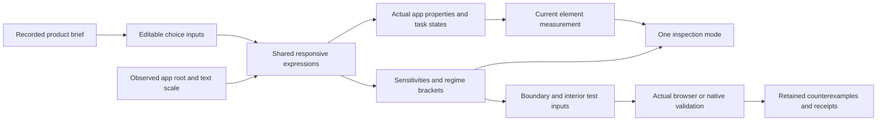

# Relay

Relay is the concrete Design Theory integration product: a local incident-management app with 120 services, 36 incidents, 1,000 traces and 24 alert rules. All telemetry and operator actions are synthetic. It runs through Expo on web, iOS and Android. It is an application with canonical state and working task flows, rather than a component catalog or layout composer.

The [integration direction](DESIGN.md) and [complete behavior brief](../../experiments/relay/shared/BRIEF.md) define acceptance. The initial functional implementation was copied into this separate product from the completed Sol trial; [source provenance](integration-origin.json) preserves that origin. It is not a declaration that Sol won the frozen comparison.

## Run locally

From the repository root:

```sh
npm ci
npm run build
npm ci --prefix examples/relay/app
npm start --prefix examples/relay/app
```

The app's Metro port is 8650. Use Expo's web/iOS/Android launch commands from that process. The headless toolkit remains usable without launching the app or a model.

## Inspect a decision in the product

Open **Inspect** from navigation or Settings. Select a currently mounted surface. Web draws its actual viewport bounding box; the dock becomes a phone sheet on narrow layouts. The application remains usable behind this nonmodal inspection surface. The inspector reports current source/input context, computed text declarations, observed local content dimensions where available, and explicit missing or unsupported measurements.

The consequence readout uses the same [responsive expressions](app/src/design/layout-policy.mjs) that drive navigation fit, paired charts and spacing. Choose a quantity to see its width/text-scale sensitivities, conservative mathematical envelope and transition brackets. Edit font axes, text scale or other preferences and observe the coupled effects. A derivative or bracket describes that declared model; actual wrapping, native axis support and text ink require separate renderer facts.



The web root uses ResizeObserver content dimensions; native uses Yoga `onLayout` dimensions from the outer keyboard-avoidance view. The shared safe padding is subtracted explicitly. Nominal windows, local coordinates, viewport bounds and native modal projections are not interchangeable. Initial nominal inputs and later held inputs are labeled. Receiving a root event does not independently verify the root adapter.

## Reproduce evidence

```sh
node scripts/prove-relay-static.mjs
node scripts/prove-relay-web.mjs
```

The first runs the product tests/typecheck and actual Expo web/iOS/Android exports. The second serves that exact current export on an ephemeral local port, exercises complete primary and secondary flows in Chromium/WebKit at desktop, phone and iPad sizes, checks live inspection, and tests mathematical regime boundaries/interiors against actual geometry. The ordered repository Expo verification stage runs both. Receipts, failures and screenshots remain under `artifacts/relay-integration`; their source identities determine applicability. A static native export is not a device task-flow receipt, and web tablet screenshots do not establish native iPad behavior.

The app retains historical choice presets as editable starting inputs. Those are not fresh solver recipes. The toolkit's staged System1 selection/replay, named-property checks and actual platform measurements must have their own current execution trail before a new choice can be called selected, replayed or renderer-verified. CSS finishes remain bounded appearance approximations; native finishes and modal-coordinate drawings have explicit unsupported capabilities. Human preference, award quality, physical Safari performance and comparative token savings remain unproven.
